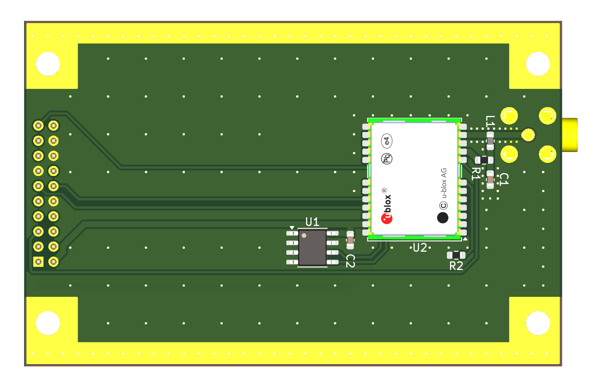

# NEO-OEM719-Adaptor

A PCB adaptor for converting NEO series footprint into an OEM719 form factor.

This PCB is also footprint compatible with the SkyTraq S1216, PX1120S and Orion B16.
To use a SkyTraq module, all resistors, capacitors, inductors and eeprom should be removed.

